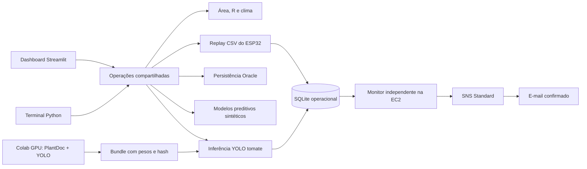

# Arquitetura geral — FarmTech Solutions

O projeto mantém dados, modelos, SQL, circuito e evidências anteriores. A implementação
compartilhada fica em `farmtech/services/{inicial,iot,oracle,preditivo,visao,alertas}`.
Os entrypoints antigos continuam como adaptadores. Não há API HTTP própria: dashboard
e CLI usam `farmtech.operations.execute(service, **parameters)`.

## Contratos

Cada operação retorna JSON com `id`, `servico`, `sucesso`, `dados`, `arquivos`,
`erro`, `duracao_s` e `saida`. O terminal retorna código 0 no sucesso e 1 na falha.
Dependências de Oracle e YOLO são carregadas ao usar cada serviço. A dashboard
isola falhas nos painéis e serviços; uma integração ausente não derruba as outras.

Eventos têm identificador, origem (`sensores`/`visao`), talhão, horário observado,
payload e horário de recebimento. CSV histórico usa UTC-03; replay `--live-time`
gera novos horários UTC e mantém a data original no payload. Reimportar o CSV
sem esse argumento é idempotente. Toda leitura reproduzida fica marcada `simulado`.

SQLite em `FARMTECH_STATE_DIR` mantém eventos, execuções e outbox. Oracle mantém a
tabela acadêmica existente. A importação Oracle usa transação e lock da tabela,
gera ID por MAX+1 e compara os campos de leitura antes de incluir. Uma falha reverte
todo o lote; a sugestão textual não define a identidade de uma leitura. Datas Oracle
são armazenadas como horário de São Paulo em TIMESTAMP sem timezone.

## Alertas

| Condição demonstrativa | Ação sugerida |
|---|---|
| Umidade <35% | Verificar talhão e avaliar irrigação; com chuva forte, adiar |
| Umidade >55% | Manter irrigação desligada e verificar drenagem |
| pH <5,8 ou >7,0 | Conferir medição e avaliar correção com responsável técnico |
| N/P/K ausente | Verificar nutriente e avaliar manejo |
| Folha com sinais de doença, confiança >=0,50 | Registrar imagem e inspecionar com responsável técnico |

Os limites iguais às bordas são adequados. As faixas são escolhas acadêmicas
configuradas no serviço, não prescrições universais por cultura. As regras de alerta
não alteram automaticamente o relé do ESP32. A regra histórica de acionamento do
protótipo continua no sketch; recomendações preditivas são outra camada demonstrativa.

O monitor acorda a cada 10s, avalia até 100 eventos e publica até 100 mensagens por
ciclo. Consolida condições novas da mesma leitura e suprime cada regra equivalente
por talhão durante 30 minutos após publicação, ou enquanto estiver pendente.
Falhas permanecem na fila com espera de 10s, 20s, 40s até 1h. Erros de credenciais
exigem correção pelo operador; não são interpretados como sucesso.

Um lease de 120s recupera publicação interrompida. `BEGIN IMMEDIATE` serializa
reservas da fila. A aceitação pelo SNS grava `MessageId`; não comprova chegada
na caixa. SNS Standard e falha entre envio e commit permitem duplicação eventual:
o identificador do evento ajuda a reconhecer o mesmo alerta.

O monitor só processa dados gravados no sistema: não extrai leituras automaticamente
do Wokwi. O replay integra o CSV; imagens são submetidas na dashboard ou CLI.

## Modelos e adaptação

A base ampliada e os alvos dos modelos preditivos são sintéticos; suas métricas medem
esse experimento. Os resultados históricos de garrafas/mochilas ficam separados
do detector agrícola, que utiliza pesos produzidos pelo treinamento PlantDoc.
Nenhum resultado anterior substitui sua avaliação. Sem bundle, a interface informa
indisponibilidade; sem caixas detectadas, mostra resultado inconclusivo.

Trocar de setor exige ajustar esquema de dados, regras e classes/modelos quando
necessário; não é suficiente trocar valores de CSV quando a semântica muda.

Eventos inválidos ficam preservados com `processed=-1` e `error`, visíveis no histórico; o monitor continua processando os demais. A migração do SQLite acrescenta essa coluna sem apagar registros.

## Infraestrutura e documentação

Na AWS, dashboard e monitor executam como serviços independentes na EC2. O SDK
obtém credenciais pelo perfil da instância. O Parameter Store guarda a configuração
Oracle criptografada; o bucket privado transporta os artefatos de instalação.
O treinamento com GPU ocorre no Colab, fora da EC2.

- [Arquitetura AWS](aws.md): componentes, rede, identidade e fluxo de alertas.
- [Colab](colab.md): dados, preparação, treinamento e exportação do detector.
- [Resultados de visão](resultados-visao.md): métricas, exemplos e limitações.
