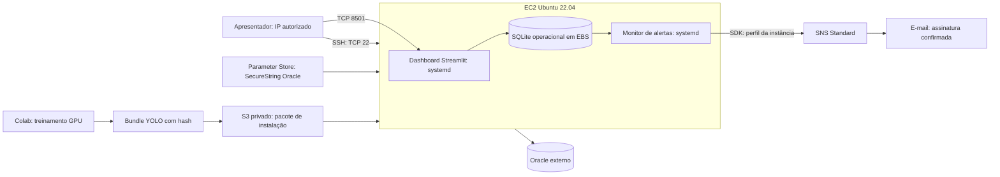

# Arquitetura AWS — FarmTech Solutions

## Computação

A aplicação usa uma EC2 `t3.medium`, Ubuntu 22.04, com volume EBS `gp3` de 30 GB
criptografado. Dashboard e monitor são processos independentes gerenciados pelo
`systemd`, com inicialização automática e reinício em caso de falha. Encerrar a
interface não interrompe o processamento de alertas. A região adotada é `us-east-1`,
sujeita à disponibilidade e às permissões do AWS Academy.

A EC2 executa Python 3.11, R e inferência YOLO em CPU. Os treinamentos ocorrem no
Colab com GPU. O bundle exportado contém pesos, classes, versões, métricas e SHA-256.

## Rede e acesso

O grupo de segurança permite SSH na porta 22 e Streamlit na porta 8501 somente
para o IP público autorizado do apresentador, com máscara `/32`. A dashboard é
acessada diretamente na EC2; esta arquitetura de demonstração usa HTTP nessa porta.
As integrações externas exigem saída para AWS, Oracle e a API climática.
O Systems Manager fornece o canal administrativo usado na configuração.

## Identidade e configuração

A instância usa o `LabInstanceProfile` e o `LabRole` disponibilizados pelo laboratório.
IMDSv2 é obrigatório, e o SDK obtém credenciais temporárias pelo perfil da instância.
A aplicação não contém chaves AWS estáticas.

Somente `ORACLE_USER`, `ORACLE_PASSWORD` e `ORACLE_DSN` são armazenados no parâmetro
`/farmtech/fase7/oracle`, do tipo `SecureString`, no Parameter Store. A configuração
é recuperada na instalação e gravada no `.env` da EC2 com permissão `600`.
Os segredos não integram o pacote do projeto nem as evidências.

## Persistência e distribuição

O SQLite operacional em `/var/lib/farmtech` mantém execuções, eventos e a fila de
mensagens. O volume EBS preserva esse estado entre reinícios da instância; o SQLite
não substitui o banco Oracle, responsável pelos registros estruturados do serviço
de dados. A exclusão do volume implica perda desse estado local.

O S3 privado transporta pacotes de instalação e evidências, com bloqueio de acesso
público, criptografia SSE-S3 e expiração dos artefatos em sete dias. A instalação
confere o SHA-256 do pacote antes de utilizá-lo. O bucket não é dependência da
aplicação durante sua operação normal.

## Fluxo de alertas

Leituras simuladas e resultados visuais são registrados como eventos no SQLite.
A cada dez segundos, o monitor avalia novos eventos e consolida as condições da
mesma leitura em uma mensagem. A fila persistente mantém mensagens pendentes,
tentativas e o identificador retornado pelo SNS.

O tópico SNS Standard distribui os alertas à assinatura de e-mail confirmada.
Condições equivalentes são suprimidas por talhão durante trinta minutos. Falhas
de publicação usam espera progressiva, e reservas interrompidas podem ser
recuperadas após reinício. A entrega pode ocorrer mais de uma vez; o identificador
do evento permite reconhecer repetições. O `MessageId` confirma aceite pelo SNS;
recebimento na caixa de e-mail é uma evidência distinta.

As regras e os contratos compartilhados pela dashboard e CLI estão na
[arquitetura geral](arquitetura.md). O ambiente depende da duração, dos limites de
orçamento e das permissões da sessão AWS Academy.
