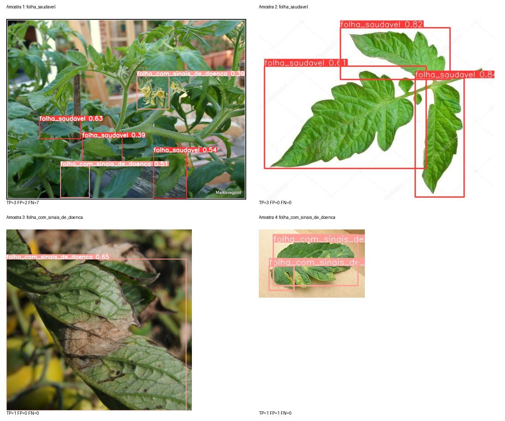

# Detector agrícola — resultados reais

Treinamento no Colab 2026.07/Python 3.12.13, Tesla T4, YOLOv5s v7.0 com pesos COCO.
Fonte: [PlantDoc Object Detection](https://github.com/pratikkayal/PlantDoc-Object-Detection-Dataset).
Classes: folha saudável e folha com sinais de doença. Dados: 530 treino / 134 validação / 69 teste.
Imagens RGB/JPEG normalizadas, EXIF removido sem girar os pixels das anotações.
Fingerprint: `270ea348033b00506793efd022cbfd1416f312a7d7fe1377bd60abd2e850b509`.

## Seleção exclusivamente pela validação

| Épocas do experimento | mAP50 validação | mAP50:95 validação | Treinamento (s) |
|---|---:|---:|---:|
| 30 | 0,7131 | 0,4092 | 978.4 |
| 60 | 0,6991 | 0,3971 | 1865.4 |

Foi selecionado o `best.pt` do experimento de **30 épocas**.
O treino mais longo não melhorou a validação. Nenhuma seleção foi feita pelo teste.
Uma tentativa anterior, interrompida após a auditoria EXIF, permanece separada no Drive
e não participa desta comparação.

## Teste reservado do modelo selecionado

| Métrica de detecção | Resultado (0–1) |
|---|---:|
| Precision | 0,5567 |
| Recall | 0,6263 |
| mAP@0.5 | 0,6115 |
| mAP@0.5:0.95 | 0,3758 |
| mAP50:95 — saudável | 0,2672 |
| mAP50:95 — sinais de doença | 0,4845 |

Os tempos GPU do avaliador foram 0.30 ms de pré-processamento,
6.75 ms de inferência e 3.30 ms de NMS por imagem.
Esses tempos não incluem carregamento de modelo e não devem ser comparados diretamente
com a duração da operação completa em CPU.

## Verificação real em CPU

Quatro imagens foram escolhidas pelos rótulos e ordem dos hashes, antes de examinar
as predições: duas de cada classe exclusiva. A revisão ocorre após a avaliação final.
TP/FP/FN usam confiança >=0,25 e IoU >=0,5. A regra de alerta usa confiança >=0,50.

| Amostra | Rótulo de origem | TP | FP | FN | Regra de inspeção acionada |
|---|---|---:|---:|---:|---|
| 1 | folha_saudavel | 3 | 2 | 7 | Sim |
| 2 | folha_saudavel | 3 | 0 | 0 | Não |
| 3 | folha_com_sinais_de_doenca | 1 | 0 | 0 | Sim |
| 4 | folha_com_sinais_de_doenca | 1 | 1 | 0 | Sim |

A amostra 1 gerou um falso alerta em imagem rotulada como saudável, além de omissões.
A amostra 2 demonstrou as três caixas saudáveis; a amostra 3 demonstrou uma caixa
correta de sinais de doença. A amostra 4 contém uma caixa correta e uma extra.
Confiança não é precisão; o resultado é de um protótipo com falsos positivos e falsos
negativos, e deve sugerir inspeção humana. Não foi feito ajuste pelo teste após essa revisão.

Nenhum e-mail/SMS AWS foi enviado nesta verificação. A regra local de inspeção foi
avaliada sobre as detecções reais; implantação e comprovação SNS ficam para depois,
conforme solicitado pelo aluno.

## Rastreabilidade

Pesos: SHA-256 `318e984ffa3f07744ebc19ad42c7844da1978208030124e5f34552c53aaa6832`.
Commit YOLO: `915bbf294bb74c859f0b41f1c23bc395014ea679`.
Versões e seleção integral ficam no bundle em `models/tomate` e nos arquivos de evidência.
Os resultados históricos de garrafas/mochilas da Fase 6 usam outro dataset e não são
atribuídos ao detector agrícola.
